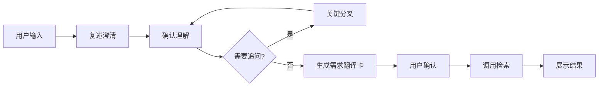

# 📚 文献检索需求翻译 Agent

> 智能文献检索辅助工具，帮你把模糊的研究兴趣翻译成精准的检索计划

[](https://www.python.org/)
[](LICENSE)
[](http://makeapullrequest.com)

---

##  项目官网

**[https://weixiao-czy.github.io/data_base_agent](https://weixiao-czy.github.io/data_base_agent)**

在线浏览项目介绍、功能演示与需求翻译卡示例，快速了解 Agent 如何帮你把模糊的研究兴趣翻译成精准的检索计划。

---

## 🎯 项目简介 

**你是否遇到过这些问题？**

- ❌ 想搜文献但不知道用什么关键词
- ❌ 检索结果太多太杂，找不到想要的
- ❌ 不清楚自己的研究问题该怎么表述

**本 Agent 来帮你！** 🚀

通过最多 10 轮简单的对话，帮你把模糊的研究兴趣翻译成精准的检索计划，并调用 Crossref / arXiv 公开学术接口检索真实文献。

---

## ✨ 核心特性

### 🤖 智能对话澄清
- 最多 10 轮对话，不会无限追问
- 先给假设，让你修正，而不是空白提问
- 支持跳过、退出，随时掌控节奏

### 📋 需求翻译卡
自动生成结构化的检索计划：
- ✅ 研究问题解读
- ✅ 关键词组合（主要/变体/相邻领域）
- ✅ 检索查询建议
- ✅ 不确定性标注

### 🔍 文献检索
- **SciMaster MCP**（优先）：通过 MCP 协议调用 SciMaster 检索，需配置 API Key
- **Crossref + arXiv**（自动降级）：免费公开 API，无需 Key，SciMaster 不可用时自动切换
- 返回论文元数据、摘要、URL、DOI、BibTeX
- 检索失败自动降级，用户无感知

---

## 🏗️ 项目结构

```
databaseagent/
├── 📁 src/
│   ├── 🤖 agent/          # Agent 核心逻辑
│   │   ├── state_machine.py   # 状态机（控制对话流程）
│   │   ├── clarifier.py       # 澄清器（复述、追问、收敛）
│   │   ── plan_card.py       # 需求翻译卡生成
│   ├── 🔍 search/         # 检索功能
│   │   ├── provider.py        # 检索接口抽象
│   │   ├── fallback_provider.py  # 自动降级链（优先级切换）
│   │   ├── scimaster_mcp.py   # SciMaster MCP 检索（优先）
│   │   ├── real_search.py     # Crossref + arXiv（降级兜底）
│   │   ── scimaster_cli.py   # SciMaster CLI（最后降级）
│   ├── 🎨 presentation/   # 结果展示
│   │   ── render_results.py  # 格式化输出
│   ├── 📝 prompts/        # 提示词模板
│   └── ️ gui/            # 桌面 GUI
│       ├── main_window.py     # 主窗口（侧边栏 + 聊天）
│       ├── chat_widget.py     # 聊天显示组件
│       ├── agent_worker.py    # Agent 后台线程
│       ├── settings_dialog.py # 设置对话框
│       └── styles.py          # 样式定义
├── 📁 config/             # 配置文件
├── 📄 gui_launcher.py     # GUI 启动脚本
├── 📄 build_exe.py        # PyInstaller 打包脚本
├── 📄 .env.example        # 环境变量示例
└── 📄 requirements.txt    # 依赖包
```

---

## 🚀 快速开始

### 1️⃣ 安装依赖

```bash
pip install -r requirements.txt
```

### 2️ 配置环境变量

```bash
# 复制示例配置
cp .env.example .env

# 编辑 .env，填入你的 API Key（可选）
# - 不填 SciMaster Key → 自动使用 Crossref/arXiv（免费）
# - 填入 SciMaster Key → 优先使用 SciMaster，失败自动降级
```

### 3️⃣ 运行 Agent

**命令行模式：**
```bash
python src/main.py
```

**桌面 GUI 模式：**
```bash
python gui_launcher.py
```

GUI 功能：
- 白色纯净风格，类似 Claude 桌面版
- 左侧边栏：对话历史 + 设置
- 气泡式对话界面，类似 OpenWebUI
- 导出需求翻译卡 / 检索结果为 txt
- 设置面板：配置 API Key、Base URL、模型等
- 对话自动保存到本地

**打包为独立 exe：**
```bash
pip install pyinstaller
python build_exe.py
```
生成的 exe 位于 `dist/LiteratureSearchAgent/`，无需 Python 环境即可运行。

### 4️⃣ 开始对话

```
请描述你的研究兴趣：
> 我想做大模型辅助文献检索

我理解你关注的是「大模型辅助文献检索」相关的问题。

你更接近哪个方向？
1. 大模型在文献检索中的应用（交互设计方向）
2. 大模型在文献检索中的应用（算法优化方向）
3. 大模型在文献检索中的应用（效果评估方向）
```

---

## 📊 工作流程



---

## 🎓 设计理念

### 对话式澄清 ≠ 拷问

我们遵循以下原则：

1. **先给假设，再修正** - 不让用户从零开始想
2. **每次只问一个关键问题** - 降低认知负担
3. **最多 10 轮** - 充分澄清，不浪费时间
4. **允许"不知道"** - 用排除法或选项辨认
5. **透明化进度** - 告诉用户还剩几步

---

## 🛠️ 技术栈

- **Python 3.8+** - 主要开发语言
- **状态机模式** - 控制对话流程
- **MCP 协议** - SciMaster 文献检索（优先）
- **Crossref / arXiv API** - 免费文献检索（自动降级）
- **PyYAML** - 需求翻译卡序列化

---

## 🤝 贡献

欢迎提交 Issue 和 Pull Request！

如有任何 BUG 或改进建议，欢迎通过 Issue 反馈，或直接联系：<harry20080428@sjtu.edu.cn>

---

## 📄 许可证

本项目基于 [MIT License](LICENSE) 开源。

---

##  团队

文献检索辅助项目

### 贡献者

- [weixiao-czy](https://github.com/weixiao-czy) — 项目负责人
- [SunSean-1145](https://github.com/SunSean-1145) — 团队成员

---

<div align="center">

**如果这个项目对你有帮助，请给个 Star ⭐！**

[返回顶部](#-文献检索需求翻译-agent)

</div>
