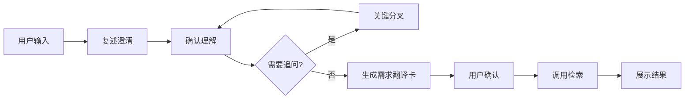

# 📚 文献检索需求翻译 Agent

> 面向上海交通大学学生的智能文献检索辅助工具

[](https://www.python.org/)
[](LICENSE)
[](http://makeapullrequest.com)

---

## 🎯 项目简介

**你是否遇到过这些问题？**

- ❌ 想搜文献但不知道用什么关键词
- ❌ 检索结果太多太杂，找不到想要的
- ❌ 不清楚自己的研究问题该怎么表述

**本 Agent 来帮你！** 🚀

通过 2-3 轮简单的对话，帮你把模糊的研究兴趣翻译成精准的检索计划，并调用 SciMaster 检索相关文献。

---

## ✨ 核心特性

### 🤖 智能对话澄清
- 最多 10 轮对话，不会无限追问
- 先给假设，让你修正，而不是空白提问
- 支持跳过、退出，随时掌控节奏

### 📋 需求翻译卡
自动生成结构化的检索计划：
- ✅ 研究问题解读
- ✅ 关键词组合（主要/变体/相邻领域）
- ✅ 检索查询建议
- ✅ 不确定性标注

### 🔍 文献检索
- 集成 SciMaster/PaSaMaster MCP 接口
- 支持 CLI 降级方案
- 返回论文元数据、摘要、URL、BibTeX

---

## 🏗️ 项目结构

```
databaseagent/
├── 📁 src/
│   ├── 🤖 agent/          # Agent 核心逻辑
│   │   ├── state_machine.py   # 状态机（控制对话流程）
│   │   ├── clarifier.py       # 澄清器（复述、追问、收敛）
│   │   └── plan_card.py       # 需求翻译卡生成
│   ├── 🔍 search/         # 检索功能
│   │   ├── provider.py        # 检索接口抽象
│   │   ├── scimaster_mcp.py   # MCP 调用
│   │   └── scimaster_cli.py   # CLI 降级
│   ├── 🎨 presentation/   # 结果展示
│   │   └── render_results.py  # 格式化输出
│   ├── 📝 prompts/        # 提示词模板
│   └── main.py            # 主程序入口
├── 📁 tests/              # 测试文件
├── 📁 config/             # 配置文件
└── 📄 requirements.txt    # 依赖包
```

---

## 🚀 快速开始

### 1️⃣ 安装依赖

```bash
pip install -r requirements.txt
```

### 2️⃣ 配置 SciMaster（可选）

```bash
# 安装 SciMaster CLI
npm install -g scimaster-cli

# 初始化配置
sci init
```

### 3️⃣ 运行 Agent

```bash
python src/main.py
```

### 4️⃣ 开始对话

```
请描述你的研究兴趣：
> 我想做大模型辅助文献检索

我理解你关注的是「大模型辅助文献检索」相关的问题。

你更接近哪个方向？
1. 大模型在文献检索中的应用（交互设计方向）
2. 大模型在文献检索中的应用（算法优化方向）
3. 大模型在文献检索中的应用（效果评估方向）
```

---

## 📊 工作流程



---

## 🎓 设计理念

### 对话式澄清 ≠ 拷问

我们遵循以下原则：

1. **先给假设，再修正** - 不让用户从零开始想
2. **每次只问一个关键问题** - 降低认知负担
3. **最多 10 轮** - 充分澄清，不浪费时间
4. **允许"不知道"** - 用排除法或选项辨认
5. **透明化进度** - 告诉用户还剩几步

---

## 🛠️ 技术栈

- **Python 3.8+** - 主要开发语言
- **状态机模式** - 控制对话流程
- **MCP 协议** - 调用 SciMaster 检索
- **PyYAML** - 需求翻译卡序列化

---

## 🤝 贡献

欢迎提交 Issue 和 Pull Request！

---

## 📄 许可证

MIT License

---

## 👥 团队

上海交通大学图书馆文献检索辅助项目

---

<div align="center">

**如果这个项目对你有帮助，请给个 Star ⭐！**

[返回顶部](#-文献检索需求翻译-agent)

</div>
